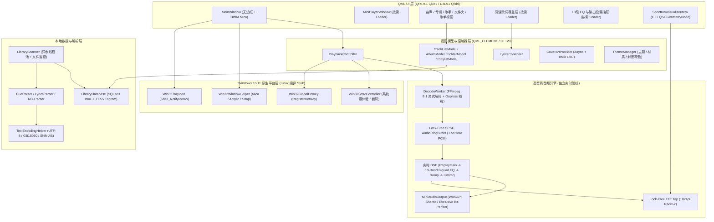
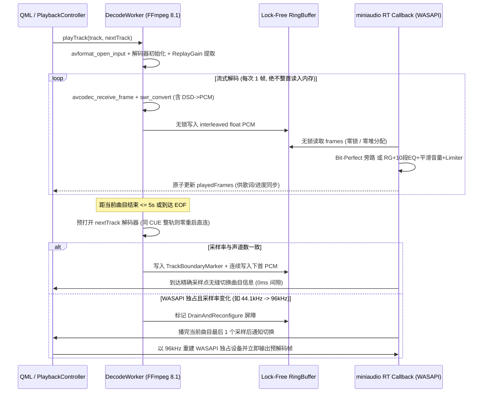

# Virela — 高颜值极致低内存本地音乐播放器实现计划

## Goal Description

构建一款面向 **Windows 10/11** 的本地音乐播放器（暂定名 **Virela**），采用 **Qt 6.9.1 (C++20 / QML)** + **FFmpeg 8.1** + **`miniaudio`** 技术栈，在实现 Apple Music 风格现代极简磨砂视觉体验与完整发烧级音频/曲库能力的同时，将常驻播放内存严格控制在 **40–80 MB** 以内。

### 核心目标与需求对齐

- **目标平台与工具链**：Windows 10/11（MSVC 2022 64-bit + CMake + Ninja + `CMakePresets.json`），同时保持核心 C++ 与 QML 跨平台可编译，以便在云端 Linux 环境持续执行核心构建与自动化测试。
- **视觉美学与低内存平衡**：默认启用 Windows 11 原生 DWM Mica / Acrylic 材质（零额外离屏模糊显存），叠加极轻量的动态封面氛围色（单层双色径向渐变着色器）；Windows 10 自动降级为轻量动态渐变，并支持在设置中自由切换材质与深/浅/跟随系统主题。
- **高音质音频引擎**：FFmpeg 8.1 流式解码（FLAC / ALAC / WAV / AIFF / APE / WavPack / MP3 / AAC / OGG / Opus / DSD `.dsf/.dff` 高精度转 PCM）+ 无锁 SPSC 环形缓冲 + `miniaudio` 底层输出（WASAPI 共享 / 独占 Bit-Perfect 模式、硬件原生采样率自动切换、Gapless 无缝衔接、ReplayGain 音量平衡、10 段双精度参数均衡器 EQ、60fps 单 Draw Call GPU 频谱可视化）。
- **本地曲库与中文生态增强**：嵌入式 SQLite3 WAL + FTS5 trigram 模糊检索、多目录异步扫描与监控、`.cue` 整轨分轨无缝播放、中文老歌曲 GBK/GB18030 元数据与 `.lrc` 歌词编码自动识别、内嵌/外挂歌词与双语翻译滚动、自建歌单与 M3U/M3U8 导入导出、拖拽即播、中/英双语界面切换。
- **Windows 系统集成**：自定义无边框原生窗口（完整 Aero Snap / 圆角 / 阴影）、Windows SMTC 锁屏与媒体键控制、原生系统托盘、全局快捷键、独立迷你悬浮播放条。
- **推进策略**：按 **Phase 1 → Phase 2 → Phase 3** 三个独立可编译、可验证的里程碑迭代交付。

---

## User Review Required

> [!IMPORTANT]
> **两项关键极致低内存架构决策（请确认）：**
> 1. **零 `Qt6::Widgets` 依赖（使用 `QGuiApplication`）**：系统托盘在 Windows 下直接通过 ~120 行原生 Win32 `Shell_NotifyIconW` 实现，文件选择器使用 `QtQuick.Dialogs` 原生对话框，完全剔除 `Qt6Widgets.dll`、`Qt6Multimedia.dll`、`Qt6Sql.dll`，静态减少约 **8–12 MB** 内存与安装包体积。
> 2. **直连 SQLite3 Amalgamation（启用 FTS5 + 4 MB 缓存硬上限）**：不通过 `Qt6::Sql` 插件层，直接编译轻量化 `sqlite3.c` 并开启 `SQLITE_ENABLE_FTS5`、`PRAGMA cache_size=-4000`、`PRAGMA mmap_size=0`，确保中英文子串模糊搜索（trigram）毫秒级响应且不因大曲库导致内存膨胀。

> [!WARNING]
> **云端 Linux 验证环境与 Windows 原生模块的协作说明：**
> 当前云端沙盒为 Ubuntu 24.04 (x86_64)。计划批准后，我将在云端安装 **Qt 6.9.1 (Linux)** 与 **FFmpeg 8.1 (Linux)**，对全部跨平台核心代码（音频解码、重采样、DSP/EQ、FFT、CUE/LRC/M3U8 解析、SQLite 曲库、QML 视图与语法）执行完整编译、单元测试、无头 QML 烟雾测试与内存检测；Windows 专属模块（`src/platform/win32/` 下的 DWM Mica、SMTC、Win32 Tray、全局热键、WASAPI 独占）将严格依据 Windows 10/11 SDK & MSVC 2022 规范编写，并附带 `CMakePresets.json` 与一键编译打包脚本 `scripts/build_windows.ps1`，方便你在 Windows 10/11 本机直接构建运行。

## Open Questions

1. **软件名称确认**：当前方案暂定工程与应用名为 **Virela**（窗口标题与进程名为 `Virela`）。如果你已有心仪名称，请在审批时告知，我在建仓阶段即统一命名。
2. **Google Drive 云端归档**：当前工作区已关联空目录 `Local_Music_App/`。审批后是否需要我把最终架构文档或每阶段交付说明/源码归档同步至该 Drive 目录？

---

## 系统架构与内存预算设计

### 总体分层架构



### 音频实时管线与 Gapless / WASAPI 独占状态流转



### 极致低内存预算（常驻目标 40–80 MB）

| 子系统 | 目标内存上限 (Private Set) | 关键工程控制手段 |
|---|---|---|
| Qt 6.9.1 核心 + QML + Quick (D3D11 QRhi) | ~26–38 MB | 仅链接 `Core/Gui/Qml/Quick/QuickControls2/QuickDialogs2`；使用 `QGuiApplication`；启用 `qmlcachegen` AOT 编译；UI 图标采用单套矢量图标字体（< 300 KB）替代海量 SVG/PNG |
| FFmpeg 8.1 流式解码 + 环形缓冲 | ~6–10 MB | 逐帧流式解码；SPSC 环形缓冲固定容量（~1.5 MB @ 96kHz/2ch/f32）；最多同时驻留 1 个活跃解码器 + 1 个 Gapless 预载解码器；停止后立即释放 `AVFormatContext` |
| `miniaudio` 音频后端 | ~1–2 MB | 宏裁剪 `MA_NO_ENGINE`、`MA_NO_DECODING`、`MA_NO_ENCODING`、`MA_NO_NODE_GRAPH`、`MA_NO_RESOURCE_MANAGER`，仅保留极简 `ma_device` |
| 封面缓存 (`CoverArtProvider`) | ~4–10 MB (硬上限) | `QImageReader::setScaledSize()` 解码期直接降采样（列表 96×96、网格/播放页 360×360）；RAM LRU 硬上限 8 MB；同专辑共用 1 份 `cover_hash` 磁盘缩略图缓存（`%LOCALAPPDATA%/Virela/cache/covers`） |
| SQLite3 + 虚拟化列表模型 | ~3–6 MB | `PRAGMA cache_size=-4000`（4 MB 封顶）、`PRAGMA mmap_size=0`；`ListView` 开启 `reuseItems: true` 与 `cacheBuffer: 240`；分页窗口加载应对数万首曲库 |
| DSP / EQ / FFT 频谱 | < 1 MB | 全静态成员数组，零动态分配；自定义 C++ `QSGGeometryNode` 单次 Draw Call 绘制 48 柱频谱，零 QML Delegate 对象；窗口最小化或暂停时自动挂起 FFT 与动画时钟 |
| Windows 11 磨砂与系统集成 | < 2 MB | 复用 DWM 原生 Mica/Acrylic（零离屏 FBO 模糊缓冲）；沉浸歌词页、EQ 面板、设置页、迷你窗全部使用 `Loader` 延迟加载并在关闭时销毁（`active: false`） |
| **稳态播放总内存** | **~42–69 MB** | 稳定落于 **40–80 MB** 极致轻量目标区间 |

---

## Proposed Changes

工程根目录位于 `/home/antigravity/virela`，按模块清晰解耦，并按 **Phase 1 → Phase 2 → Phase 3** 渐进落地。

---

### Phase 1：工程基建、FFmpeg 8.1 + `miniaudio` 播放引擎与现代极简磨砂框架

本阶段交付一个**可独立编译、可测试、可拖拽本地音乐播放、具备 Apple Music 现代磨砂主界面与无锁 Gapless 解码引擎**的完整核心骨架。

#### [NEW] [CMakeLists.txt](../CMakeLists.txt)
#### [NEW] [CMakePresets.json](../CMakePresets.json)
#### [NEW] [cmake/FindFFmpeg.cmake](../cmake/FindFFmpeg.cmake)
#### [NEW] [scripts/build_windows.ps1](../scripts/build_windows.ps1)

- 顶层 CMake 配置使用 Qt 6.9 现代范式与 C++20：
```cmake
cmake_minimum_required(VERSION 3.28)
project(Virela VERSION 0.1.0 LANGUAGES C CXX)

set(CMAKE_CXX_STANDARD 20)
set(CMAKE_CXX_STANDARD_REQUIRED ON)
set(CMAKE_CXX_EXTENSIONS OFF)

find_package(Qt6 6.9 REQUIRED COMPONENTS
    Core Gui Qml Quick QuickControls2 QuickDialogs2 LinguistTools
)
qt_standard_project_setup(
    REQUIRES 6.9
    I18N_SOURCE_LANGUAGE en
    I18N_TRANSLATED_LANGUAGES zh_CN
)
```
- `CMakePresets.json` 预设三组配置：
  - `windows-msvc-release` / `windows-msvc-debug`（MSVC 2022 + Ninja，自动读取 `$env{QT6_DIR}` 与 `$env{FFMPEG_ROOT}`）
  - `linux-dev-test`（云端 Linux 持续编译、运行 `ctest`、ASan/LSan 内存检测与 `qmllint`）
- `cmake/FindFFmpeg.cmake` 兼容 Windows 预编译包（BtbN / gyan.dev `include/` + `lib/` + `bin/*.dll`）与 Linux `pkg-config` / 自定义 `FFMPEG_ROOT`，并导出目标 `FFmpeg::avformat`、`FFmpeg::avcodec`、`FFmpeg::avutil`、`FFmpeg::swresample`。
- `scripts/build_windows.ps1` 自动执行配置、编译、`windeployqt --qmldir qml`、复制 FFmpeg 8.1 DLL 并生成便携发布目录。

#### [NEW] [third_party/miniaudio/miniaudio.h](../third_party/miniaudio/miniaudio.h)
#### [NEW] [third_party/miniaudio/miniaudio_impl.c](../third_party/miniaudio/miniaudio_impl.c)
#### [NEW] [third_party/sqlite3/sqlite3.h](../third_party/sqlite3/sqlite3.h)
#### [NEW] [third_party/sqlite3/sqlite3.c](../third_party/sqlite3/sqlite3.c)

- `miniaudio_impl.c` 使用精简宏裁剪（`MA_NO_ENGINE`、`MA_NO_DECODING`、`MA_NO_ENCODING`、`MA_NO_NODE_GRAPH`、`MA_NO_RESOURCE_MANAGER`），避免引入多余代码与运行时内存。
- `sqlite3.c` 以静态库编译并启用 `SQLITE_ENABLE_FTS5`、`SQLITE_THREADSAFE=1`、`SQLITE_DEFAULT_MEMSTATUS=0`。

---

### 核心音频引擎 (`src/audio/`)

#### [NEW] [src/audio/AudioTypes.h](../src/audio/AudioTypes.h)
#### [NEW] [src/audio/AudioRingBuffer.h](../src/audio/AudioRingBuffer.h)
#### [NEW] [src/audio/FFmpegDecoder.h](../src/audio/FFmpegDecoder.h)
#### [NEW] [src/audio/FFmpegDecoder.cpp](../src/audio/FFmpegDecoder.cpp)
#### [NEW] [src/audio/IAudioOutput.h](../src/audio/IAudioOutput.h)
#### [NEW] [src/audio/MiniAudioOutput.h](../src/audio/MiniAudioOutput.h)
#### [NEW] [src/audio/MiniAudioOutput.cpp](../src/audio/MiniAudioOutput.cpp)
#### [NEW] [src/audio/PlaybackEngine.h](../src/audio/PlaybackEngine.h)
#### [NEW] [src/audio/PlaybackEngine.cpp](../src/audio/PlaybackEngine.cpp)

- **`AudioRingBuffer`**：单生产者/单消费者（SPSC）无锁浮点帧环形缓冲，2 的幂次容量，`alignas(64)` 消除读写索引伪共享（false sharing），支持带代际版本号（`generation`）的原子清零以实现无撕裂 Seek。
- **`FFmpegDecoder`**（严格采用 FFmpeg 8.1 现代 API，不使用已移除的旧接口）：
  - 使用 `AVChannelLayout`、`swr_alloc_set_opts2`、`avcodec_send_packet` / `avcodec_receive_frame`。
  - 支持流式区间解码（`startMs` / `endMs`，为 Phase 2 的 `.cue` 虚拟分轨做好原生支持）。
  - DSD (`.dsf` / `.dff`) 识别并配置高精度 `SwrContext` 降采样（Kaiser 窗 / 三角高通抖动 `SWR_DITHER_TRIANGULAR_HIGHPASS`）至目标 PCM 采样率（默认 88.2 kHz / 176.4 kHz 或匹配设备采样率）。
  - 元数据与技术参数探针 `probeFile()`：提取编解码器、采样率、位深、码率、声道布局、时长、ReplayGain（优先 `av_packet_side_data_get(..., AV_PKT_DATA_REPLAYGAIN)`，回退至容器/流标签）、内嵌封面包及内嵌歌词。
- **`MiniAudioOutput`**：
  - Phase 1 实现设备枚举、默认设备热插拔通知回调（`notificationCallback`）、WASAPI 共享模式（Linux 端自动使用 PulseAudio/ALSA 或测试用 `NullAudioOutput`）。
  - 预留 Phase 3 独占模式参数结构（`OutputMode::WasapiShared` / `OutputMode::WasapiExclusive`、`autoNativeSampleRate`、`bitPerfectBypass`）。
- **`PlaybackEngine`**：
  - 管理 `DecodeWorker` 线程、双解码器 Gapless 预加载状态机、精确 Seek（5 ms 微淡入淡出防爆音）、播放队列模式（顺序、单曲循环、列表循环、Fisher-Yates 真随机）。

---

### 编码识别、主题系统与 Windows 原生窗口壳 (`src/core/`, `src/platform/`)

#### [NEW] [src/core/TextEncodingHelper.h](../src/core/TextEncodingHelper.h)
#### [NEW] [src/core/TextEncodingHelper.cpp](../src/core/TextEncodingHelper.cpp)
#### [NEW] [src/core/ThemeManager.h](../src/core/ThemeManager.h)
#### [NEW] [src/core/ThemeManager.cpp](../src/core/ThemeManager.cpp)
#### [NEW] [src/core/AppSettings.h](../src/core/AppSettings.h)
#### [NEW] [src/core/AppSettings.cpp](../src/core/AppSettings.cpp)
#### [NEW] [src/core/PlaybackController.h](../src/core/PlaybackController.h)
#### [NEW] [src/core/PlaybackController.cpp](../src/core/PlaybackController.cpp)
#### [NEW] [src/platform/PlatformBridge.h](../src/platform/PlatformBridge.h)
#### [NEW] [src/platform/win32/Win32WindowHelper.h](../src/platform/win32/Win32WindowHelper.h)
#### [NEW] [src/platform/win32/Win32WindowHelper.cpp](../src/platform/win32/Win32WindowHelper.cpp)
#### [NEW] [src/platform/stub/StubPlatformBridge.cpp](../src/platform/stub/StubPlatformBridge.cpp)

- **`TextEncodingHelper`**：
  - 不依赖可能缺失 ICU 的 `QStringDecoder("GB18030")`：Windows 下直调零依赖 Win32 `MultiByteToWideChar(54936, MB_ERR_INVALID_CHARS, ...)`（GB18030）与 CP 932（Shift-JIS）/ CP 950（Big5）；Linux 下直调 glibc `iconv`。
  - 专门处理 FFmpeg 读取老旧 ID3v1 / Latin1 标记 ID3v2 时产生的“假 Latin1 UTF-8 乱码”（检测全串码点落在 `U+0000..U+00FF` 且含高位字节时还原原始字节流并用 GB18030 重解码验证）。
- **`ThemeManager`**（`QML_SINGLETON`）：
  - 管理深色 / 浅色 / 跟随系统主题、材质模式（`Mica` / `Acrylic` / `AmbientGradient` / `Solid`）以及中/英语言切换（动态加载 `QTranslator` + `QQmlEngine::retranslate()`）。
  - 从 32×32 缩小封面图中通过中位切分 / k-means(k=3) 提取主色与点缀色，输出柔和低饱和度氛围双色（确保文字 WCAG AA 对比度达标）。
- **`Win32WindowHelper`**：
  - 通过 `QAbstractNativeEventFilter` 接管 `WM_NCCALCSIZE`、`WM_NCHITTEST`、`WM_GETMINMAXINFO`，实现无边框自定义标题栏同时完整保留 Win11 Aero Snap 分屏、最大化边缘防裁剪、窗口阴影与圆角（`DWMWA_WINDOW_CORNER_PREFERENCE`）。
  - 检测 Windows Build 版本：Win11 (≥ 22621) 调用 `DwmSetWindowAttribute(hwnd, DWMWA_SYSTEMBACKDROP_TYPE, ...)` 应用 Mica / Acrylic，并同步 `DWMWA_USE_IMMERSIVE_DARK_MODE`；Win10 自动通知 QML 切换至轻量动态氛围渐变。

---

### QML 现代极简磨砂主界面 (`qml/`, `src/main.cpp`)

#### [NEW] [src/main.cpp](../src/main.cpp)
#### [NEW] [qml/Main.qml](../qml/Main.qml)
#### [NEW] [qml/theme/DesignTokens.qml](../qml/theme/DesignTokens.qml)
#### [NEW] [qml/components/AmbientBackdrop.qml](../qml/components/AmbientBackdrop.qml)
#### [NEW] [qml/components/TitleBar.qml](../qml/components/TitleBar.qml)
#### [NEW] [qml/components/Sidebar.qml](../qml/components/Sidebar.qml)
#### [NEW] [qml/components/PlaybackBar.qml](../qml/components/PlaybackBar.qml)
#### [NEW] [qml/components/QueueDrawer.qml](../qml/components/QueueDrawer.qml)
#### [NEW] [qml/components/FormatBadge.qml](../qml/components/FormatBadge.qml)
#### [NEW] [translations/virela_zh_CN.ts](../translations/virela_zh_CN.ts)
#### [NEW] [translations/virela_en_US.ts](../translations/virela_en_US.ts)

- **视觉语言（Apple Music 现代极简磨砂风）**：
  - 字体层级：Windows 首选 `Segoe UI Variable` + `Microsoft YaHei UI`，严格字号/字重阶梯与 1 px 半透明发丝描边。
  - 动态氛围底色：`AmbientBackdrop.qml` 使用极轻的双色平滑过渡（`ColorAnimation 500ms`），在 Win11 Mica 开启时仅以 12%–18% 极低不透明度叠层，既透出桌面 Mica 质感又带有专辑氛围色彩。
  - 全局 `DropArea`：直接拖入音频文件、文件夹、`.cue`、`.m3u8` 即时播放或入队。
  - 播放控制栏集成：圆角封面、歌曲名/歌手、无损/Hi-Res/DSD 徽章、播放控制、悬停预览时间轴、队列抽屉、音量控制。

---

### Phase 2：本地曲库、SQLite FTS5、`.cue` 分轨、歌词系统与歌单管理

本阶段在 Phase 1 引擎和 UI 骨架之上，构建完整的本地音乐资料库与沉浸歌词体验。

#### [NEW] [src/library/LibraryDatabase.h](../src/library/LibraryDatabase.h)
#### [NEW] [src/library/LibraryDatabase.cpp](../src/library/LibraryDatabase.cpp)
#### [NEW] [src/library/CueParser.h](../src/library/CueParser.h)
#### [NEW] [src/library/CueParser.cpp](../src/library/CueParser.cpp)
#### [NEW] [src/library/LibraryScanner.h](../src/library/LibraryScanner.h)
#### [NEW] [src/library/LibraryScanner.cpp](../src/library/LibraryScanner.cpp)
#### [NEW] [src/library/M3uPlaylistIO.h](../src/library/M3uPlaylistIO.h)
#### [NEW] [src/library/M3uPlaylistIO.cpp](../src/library/M3uPlaylistIO.cpp)
#### [NEW] [src/library/CoverArtProvider.h](../src/library/CoverArtProvider.h)
#### [NEW] [src/library/CoverArtProvider.cpp](../src/library/CoverArtProvider.cpp)

- **SQLite3 数据库 Schema 核心设计**：
  - `folders`：监听根目录与上次扫描时间戳。
  - `tracks`：支持物理文件与 `.cue` 虚拟分轨（`is_cue`, `cue_path`, `start_ms`, `end_ms`），记录完整标签、技术元数据、ReplayGain、`cover_hash`、收藏、播放次数、最近播放时间。
  - `tracks_fts`：`CREATE VIRTUAL TABLE tracks_fts USING fts5(title, artist, album, album_artist, file_path, content='tracks', content_rowid='id', tokenize='trigram');` — 自动触发器同步，中英文任意子串搜索 < 5 ms。
  - `playlists` & `playlist_items`：自定义歌单与有序曲目关联。
- **`.cue` 整轨分轨解析器 (`CueParser`)**：
  - 通过 `TextEncodingHelper` 自动识别 UTF-8 / GB18030 / Shift-JIS；完整解析 `PERFORMER`、`TITLE`、`FILE`、`TRACK`、`INDEX 00/01`、`REM DATE/GENRE`。
  - 扫描器发现有效 `.cue` 指向的整轨音频时，自动折叠原始整轨文件，入库各分轨并记录精确 `start_ms` / `end_ms`；播放相邻分轨时触发 `FFmpegDecoder` 零重启无缝直连。
- **`CoverArtProvider`**（`QQuickAsyncImageProvider`）：
  - URI 规范：`image://cover/<cover_hash>?size=96` 或 `size=360`。
  - 封面查找优先级：音频内嵌 `AV_DISPOSITION_ATTACHED_PIC` → 同目录 `cover/folder/front/album.(jpg|png|webp)` → 同名图片文件。
  - 两级缓存：内存 LRU 严格封顶 **8 MB** + 磁盘 `%LOCALAPPDATA%/Virela/cache/covers/` 缩略图缓存，滚动上千张专辑不爆内存、不卡顿。

#### [NEW] [src/lyrics/LyricsParser.h](../src/lyrics/LyricsParser.h)
#### [NEW] [src/lyrics/LyricsParser.cpp](../src/lyrics/LyricsParser.cpp)
#### [NEW] [src/lyrics/LyricsController.h](../src/lyrics/LyricsController.h)
#### [NEW] [src/lyrics/LyricsController.cpp](../src/lyrics/LyricsController.cpp)

- 优先级：同名 `.lrc` 文件（自动纠错 GB18030/UTF-8/UTF-16 编码）→ 内嵌标签（`lyrics` / `USLT` / `LYRICS` / `©lyr`）。
- 支持多时间标签展开、同时间戳双语翻译合并、增强型逐字 `<mm:ss.xx>` 解析、`[offset:ms]` 偏移与应用内手动微调，二分查找当前行实现 O(log N) 极低 CPU 同步。

#### [NEW] [src/models/TrackListModel.h](../src/models/TrackListModel.h)
#### [NEW] [src/models/TrackListModel.cpp](../src/models/TrackListModel.cpp)
#### [NEW] [src/models/AlbumListModel.h](../src/models/AlbumListModel.h)
#### [NEW] [src/models/AlbumListModel.cpp](../src/models/AlbumListModel.cpp)
#### [NEW] [src/models/ArtistListModel.h](../src/models/ArtistListModel.h)
#### [NEW] [src/models/ArtistListModel.cpp](../src/models/ArtistListModel.cpp)
#### [NEW] [src/models/FolderBrowserModel.h](../src/models/FolderBrowserModel.h)
#### [NEW] [src/models/FolderBrowserModel.cpp](../src/models/FolderBrowserModel.cpp)
#### [NEW] [src/models/PlaylistModel.h](../src/models/PlaylistModel.h)
#### [NEW] [src/models/PlaylistModel.cpp](../src/models/PlaylistModel.cpp)
#### [NEW] [qml/views/TracksView.qml](../qml/views/TracksView.qml)
#### [NEW] [qml/views/AlbumsView.qml](../qml/views/AlbumsView.qml)
#### [NEW] [qml/views/AlbumDetailView.qml](../qml/views/AlbumDetailView.qml)
#### [NEW] [qml/views/ArtistsView.qml](../qml/views/ArtistsView.qml)
#### [NEW] [qml/views/FoldersView.qml](../qml/views/FoldersView.qml)
#### [NEW] [qml/views/PlaylistView.qml](../qml/views/PlaylistView.qml)
#### [NEW] [qml/views/NowPlayingOverlay.qml](../qml/views/NowPlayingOverlay.qml)
#### [NEW] [qml/components/TrackInfoDialog.qml](../qml/components/TrackInfoDialog.qml)

- 所有长列表与专辑网格采用 `QAbstractListModel` + `reuseItems: true`；`NowPlayingOverlay.qml` 仅在展开沉浸歌词页时由 `Loader` 创建，关闭后回收 GPU 资源。
- `TrackInfoDialog.qml` 完整展示文件路径、编码格式、采样率、位深、码率、声道、ReplayGain、CUE 区间与内嵌标签详情。

---

### Phase 3：发烧级 DSP / EQ、GPU 频谱可视化、WASAPI 独占与 Windows 11 桌面集成

本阶段补齐高阶发烧音频特性、低开销实时视觉反馈与深度 Windows 桌面体验。

#### [NEW] [src/audio/dsp/BiquadEq.h](../src/audio/dsp/BiquadEq.h)
#### [NEW] [src/audio/dsp/BiquadEq.cpp](../src/audio/dsp/BiquadEq.cpp)
#### [NEW] [src/audio/dsp/ReplayGainProcessor.h](../src/audio/dsp/ReplayGainProcessor.h)
#### [NEW] [src/audio/dsp/FftAnalyzer.h](../src/audio/dsp/FftAnalyzer.h)
#### [NEW] [src/audio/dsp/FftAnalyzer.cpp](../src/audio/dsp/FftAnalyzer.cpp)
#### [NEW] [src/audio/dsp/DitherConverter.h](../src/audio/dsp/DitherConverter.h)
#### [MODIFY] [src/audio/MiniAudioOutput.cpp](../src/audio/MiniAudioOutput.cpp)
#### [MODIFY] [src/audio/PlaybackEngine.cpp](../src/audio/PlaybackEngine.cpp)

- **10 段参数均衡器 (`BiquadEq`)**：中心频点 `31, 62, 125, 250, 500, 1k, 2k, 4k, 8k, 16k Hz`（±12 dB，含可调 Pre-amp 与 7 套内置预设），内部使用 `double` 精度 Direct Form II Transposed 状态机防止低频量化噪声，UI 拖动滑块时通过无锁双缓冲原子切换系数（零卡顿/零锁）。
- **WASAPI 独占与源码直出 (`MiniAudioOutput`)**：
  - 探测硬件 `nativeDataFormats`，按精度降序协商 `ma_format_f32` → `ma_format_s32` → `ma_format_s24` → `ma_format_s16`（对浮点转定点自动应用 TPDF 三角抖动）。
  - **Bit-Perfect 旁路**：当 WASAPI 独占开启、EQ 关闭、ReplayGain 关闭且软件音量为 100% 时，直通原始无损样本流不作增益运算。
  - **自动原生采样率切换**：曲目采样率变化时在排空当前尾帧后重建设备以匹配 44.1 / 48 / 88.2 / 96 / 176.4 / 192 / 352.8 / 384 kHz；独占打开失败（被其他应用占用或驱动拒绝）时自动无感降级至 WASAPI 共享模式并在 UI 发出轻量提示。

#### [NEW] [src/ui/SpectrumVisualizerItem.h](../src/ui/SpectrumVisualizerItem.h)
#### [NEW] [src/ui/SpectrumVisualizerItem.cpp](../src/ui/SpectrumVisualizerItem.cpp)
#### [NEW] [src/ui/EqCurveItem.h](../src/ui/EqCurveItem.h)
#### [NEW] [src/ui/EqCurveItem.cpp](../src/ui/EqCurveItem.cpp)
#### [NEW] [qml/views/EqDrawer.qml](../qml/views/EqDrawer.qml)
#### [NEW] [qml/views/SettingsView.qml](../qml/views/SettingsView.qml)
#### [NEW] [qml/windows/MiniPlayerWindow.qml](../qml/windows/MiniPlayerWindow.qml)

- **`SpectrumVisualizerItem`**（自定义 `QQuickItem` + `QSGGeometryNode`）：
  - 直接在 SceneGraph 渲染线程构建 48 根圆角/渐变柱状或镜像波形三角形网格（**1 次 GPU Draw Call**，零 QML Repeater 对象、零 JS 垃圾回收）。
  - 1024 点 Radix-2 FFT + Hann 窗 + 对数分频映射到 20 Hz–18 kHz + 攻击/衰减平滑滤波；当不可见、最小化或暂停时彻底停止更新，CPU 占用趋近于 0。
- **`MiniPlayerWindow.qml`**：独立置顶 340×88 px 磨砂胶囊悬浮窗，关闭即卸载释放内存。
- **`SettingsView.qml`**：输出设备/WASAPI 独占/采样率切换/DSD 目标率、EQ/ReplayGain、外观材质与主题、监听目录管理、全局快捷键自定义、语言切换、实时内存占用监视指示器。

#### [NEW] [src/platform/win32/Win32SmtcController.h](../src/platform/win32/Win32SmtcController.h)
#### [NEW] [src/platform/win32/Win32SmtcController.cpp](../src/platform/win32/Win32SmtcController.cpp)
#### [NEW] [src/platform/win32/Win32TrayIcon.h](../src/platform/win32/Win32TrayIcon.h)
#### [NEW] [src/platform/win32/Win32TrayIcon.cpp](../src/platform/win32/Win32TrayIcon.cpp)
#### [NEW] [src/platform/win32/Win32GlobalHotkey.h](../src/platform/win32/Win32GlobalHotkey.h)
#### [NEW] [src/platform/win32/Win32GlobalHotkey.cpp](../src/platform/win32/Win32GlobalHotkey.cpp)

- **`Win32SmtcController`**：通过 `ISystemMediaTransportControlsInterop::GetForWindow(hwnd)` 绑定 WinRT `SystemMediaTransportControls`（链接 `windowsapp.lib`），将曲目信息、封面缩略图流、播放状态与时间线推送至 Windows 10/11 锁屏与通知中心媒体卡片，并响应物理媒体键。
- **`Win32TrayIcon`**：纯 Win32 `Shell_NotifyIconW` + 响应深浅主题上下文菜单（播放/暂停、上/下一首、迷你模式、显示主窗口、退出），支持“关闭窗口最小化到托盘”。
- **`Win32GlobalHotkey`**：封装 `RegisterHotKey` / `UnregisterHotKey` 与冲突检测，默认快捷键支持自定义并持久化至 `AppSettings`。

---

## Verification Plan

### Automated Tests（云端 Linux 环境下每阶段强制执行）

先在云端安装 Qt 6.9.1 (Linux) 与 FFmpeg 8.1 (Linux) 并配置测试夹具（使用 `ffmpeg` 命令行生成无损 FLAC、WAV、MP3 含 GBK ID3 标签、DSD/高采样率合成正弦波测试音轨与 `.cue`/`.lrc`/`.m3u8` 样本）：

```bash
# 1. 配置与编译 (Linux 开发测试预设)
cmake --preset linux-dev-test
cmake --build --preset linux-dev-test

# 2. 运行全量 C++ 单元测试 (GoogleTest / Qt Test)
ctest --preset linux-dev-test --output-on-failure

# 3. QML 静态检查与无头运行时烟雾测试
qmllint qml/**/*.qml
QT_QPA_PLATFORM=offscreen ./build/linux-dev-test/virela --smoke-test-exit
```

各阶段单元测试覆盖清单（`tests/`）：
- **Phase 1**：`test_ring_buffer`（高并发 SPSC 读写完整性与 Seek 复位）、`test_ffmpeg_decoder`（FLAC/WAV/MP3/DSD 解码、采样率转换、ReplayGain 侧数据读取、Gapless 连续帧计数校验）、`test_text_encoding`（UTF-8 / UTF-16 / GB18030 / 假 Latin1-GBK ID3 乱码纠错）。
- **Phase 2**：`test_library_db`（SQLite3 WAL + FTS5 trigram 中英文子串模糊检索、增量扫描去重）、`test_cue_parser`（多音轨/GB18030 编码/相邻区间解析）、`test_lyrics_parser`（标准 LRC、多时间戳、双语翻译合并、增强逐字标签、偏移量）、`test_m3u_io`（M3U/M3U8 读写往返）、`test_cover_cache`（8 MB RAM LRU 淘汰上限验证）。
- **Phase 3**：`test_biquad_eq`（对 1 kHz 正弦波施加 +6 dB / -6 dB 峰值滤波后校验 RMS 幅值误差 < 0.2 dB）、`test_replay_gain`（Track/Album 增益与防削波限幅）、`test_fft_analyzer`（单频正弦波峰值频段索引精度校验）、内存基准脚本（Linux `/proc/self/status` `VmRSS` 监控 + AddressSanitizer/LeakSanitizer 零泄漏验证）。

### Manual Verification（Windows 10/11 本机验收清单）

在 Windows 10/11 执行 `.\scripts\build_windows.ps1` 构建并启动 `Virela.exe` 后，逐项验证：
1. **视觉与材质**：Windows 11 下主窗口正确透出原生 Mica/Acrylic 磨砂且 Aero Snap 拖拽分屏/圆角正常；切换不同专辑封面时背景氛围色平滑过渡；切换深/浅主题与中/英文界面即时生效无闪烁。
2. **内存占用实测**：导入 1,000+ 首本地音乐，在 Windows 任务管理器 / Process Explorer 查看 `Private Working Set`——主界面连续播放 FLAC/MP3 时应稳定处于 **40–80 MB**，快速滚动专辑网格与开关歌词/EQ 面板后内存及时回落无持续增长。
3. **音频发烧特性**：切换 WASAPI 独占模式确认系统其他提示音静音且外接 DAC / 硬件采样率随 44.1 kHz / 96 kHz / 192 kHz 曲目自动切换；播放整轨 FLAC + `.cue` 现场专辑确认曲目交界处零停顿；验证 DSD (`.dsf`) 解码流畅无爆音；拖动 10 段 EQ 与 ReplayGain 即时可闻且无杂音。
4. **桌面集成**：锁屏界面与 Win11 右下角快捷控制中心显示封面、曲名与进度且媒体键生效；关闭主窗口最小化至系统托盘；全局快捷键在后台生效；切换至迷你悬浮窗可置顶操控并流畅切回主界面。
